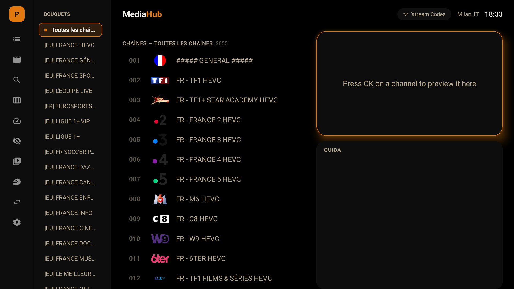

# MediaHub

Live TV, EPG, movies and series on every screen: Enigma2 (OpenWebIF), Xtream Codes, M3U, HDHomeRun and Tvheadend sources on
**Android TV**, **Windows** and a Linux mini PC image (**MediaHub OS**). The source code is not public.

## Downloads
- Android TV: [MediaHub-TV-1.0.42-20261102-1612.apk](https://drive.usercontent.google.com/download?id=1TN0Uw1AS1EWKMVSRY7jNqTF3KeeZ5NWG&export=download&confirm=t)
- Windows installer: [MediaHub-Setup-1.0.0-20261102-1612.exe](https://drive.usercontent.google.com/download?id=1Zk2tmvbUnvMJC6Mjlro7POexxPAkjGcY&export=download&confirm=t) / MSI: [MediaHub-1.0.0-20261102-1614.msi](https://drive.usercontent.google.com/download?id=136wqsmQfj6beAsRjz1p9-IwCj1uYplzQ&export=download&confirm=t)
- MediaHub OS (ISO, BIOS/UEFI): [mediahub-os-20261102-1645.iso](https://drive.usercontent.google.com/download?id=1kaO91YQxkLJ9oX0opV1UTpJc6ybqOl9C&export=download&confirm=t)

Builds are unsigned, so Windows SmartScreen / Android may ask for confirmation. Italian documentation: [README.md](README.md).

## Highlights
Two-pane Home (channel list + mini player and full channel guide), several PVR accounts with quick switch, per-channel EPG with disk cache,
Netflix-style movies and series (Xtream), radio, music, photos, recordings and timers, phone remote via QR (MediaHub OS).
