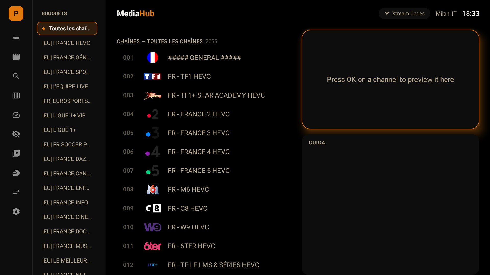
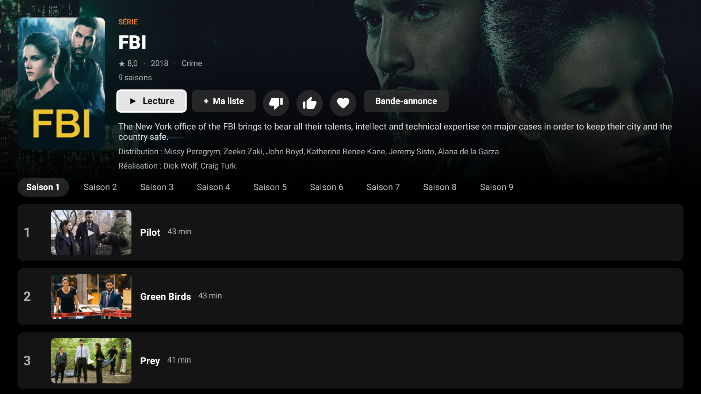

# MediaHub

**Live TV, guida EPG, film e serie su ogni schermo.** Un'unica interfaccia per guardare la TV in diretta e i contenuti on demand
da Enigma2 (OpenWebIF), Xtream Codes, liste M3U, HDHomeRun e Tvheadend: su Android TV, Windows e su qualsiasi PC x86 (MediaHub OS).

> English: [README.md](README.md)

## Download

| Versione | File | Per chi |
|---|---|---|
| **Android TV** | [`MediaHub-TV-1.0.46.apk`](https://github.com/corallocla-web/mediahub/releases/download/v1.0.48/MediaHub-TV-1.0.46.apk) | Android TV / Google TV (Sony, Nvidia Shield, Fire TV...) |
| **Windows (utente)** | [`MediaHub-Setup-1.0.6.exe`](https://github.com/corallocla-web/mediahub/releases/download/v1.0.48/MediaHub-Setup-1.0.6.exe) | Installazione senza permessi di amministratore |
| **Windows (macchina)** | [`MediaHub-1.0.6.msi`](https://github.com/corallocla-web/mediahub/releases/download/v1.0.48/MediaHub-1.0.6.msi) | Pacchetto MSI per tutto il PC (richiede amministratore) |
| **MediaHub OS (ISO)** | [`mediahub-os-20261102-1645.iso`](https://drive.usercontent.google.com/download?id=1kaO91YQxkLJ9oX0opV1UTpJc6ybqOl9C&export=download&confirm=t) | **Qualsiasi PC x86** (mini PC, Compute Stick, desktop, portatili, VM): parte direttamente in MediaHub a schermo intero. BIOS e UEFI |

Le build **non sono firmate**: Windows (SmartScreen) e Android possono chiedere una conferma all'installazione.
Elenco delle ultime 5 versioni di ogni tipo: vedi [`docs/DOWNLOAD.md`](docs/DOWNLOAD.md) e nelle [Releases](https://github.com/corallocla-web/mediahub/releases).

## Screenshot

## Cosa fa

- **Home a due metà**: lista canali con logo a sinistra; a destra miniplayer e guida completa del canale.
  OK su un canale = anteprima, OK di nuovo = schermo intero.
- **Più sorgenti e account**: Enigma2/OpenWebIF, Xtream Codes, M3U, HDHomeRun, Tvheadend; cambio rapido tra più account PVR dalla barra a sinistra.
- **Guida EPG**: per canale, con cache su disco (XMLTV) per le sorgenti Xtream.
- **Film e serie** (Xtream): catalogo in stile Netflix, "Continua a guardare", episodio successivo automatico.
- **Radio, musica, foto, registrazioni e timer**.
- **Telecomando dal telefono** (MediaHub OS): QR con F12, pannello `http://<ip>:8080/sistema`.

## Installazione

### Android TV
1. Scarica l'APK sul PC o direttamente sulla TV (app *Downloader*), oppure copialo su una chiavetta USB.
2. Abilita "Origini sconosciute" per l'app che usi per aprire il file.
3. Installa. Da PC: `adb connect <ip-della-tv>` poi `adb install -r MediaHub-TV-*.apk`.

### Windows
- **.exe**: doppio clic, si installa per l'utente corrente in `%LOCALAPPDATA%\Programs\MediaHub`. Include VLC.
- **.msi**: installazione per tutto il PC in `C:\Program Files\MediaHub` (amministratore). Aggiorna una versione già installata.
- Parte in finestra; **F11** per lo schermo intero (o dalle Impostazioni).

### MediaHub OS (ISO) - qualsiasi PC x86
1. Scrivi l'ISO su una chiavetta USB (Rufus in modalità **DD**, oppure `dd`).
2. Avvia il PC dalla chiavetta (BIOS o UEFI) e segui l'installer.
3. Al riavvio parte direttamente MediaHub a schermo intero.

Verifica il file con lo SHA256 indicato nella pagina di download.

## Primo avvio
Al primo avvio una procedura guidata chiede il tipo di sorgente e i dati di accesso (indirizzo, utente, password o URL della lista).
Sulle versioni con QR puoi inserirli dal telefono. Altri account si aggiungono dalle Impostazioni.

## Problemi noti
- **Guida Xtream vuota**: alcuni provider servono la guida XMLTV completa solo una volta e poi la limitano. MediaHub la salva su disco (validità 6 ore) e riusa l'ultima copia valida, ma serve almeno un download completo riuscito.
- **Windows**: se VLC non è installato, usa quello incluso; il primo avvio è un po' più lento.
- Le build Windows e MediaHub OS sono provate soprattutto in macchina virtuale: segnala qualsiasi problema.

## Note
MediaHub è un lettore: non include canali, liste o abbonamenti. Usalo solo con contenuti a cui hai diritto di accedere.
Il codice sorgente non è pubblico.
