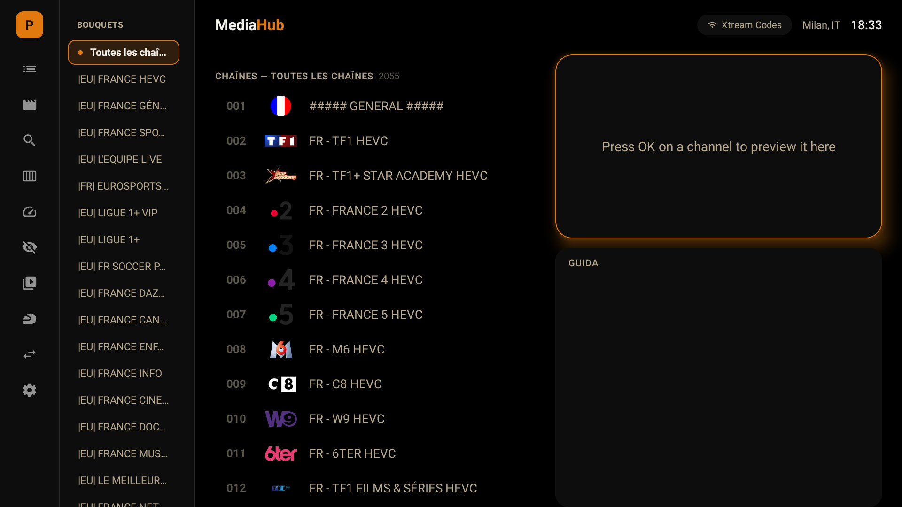
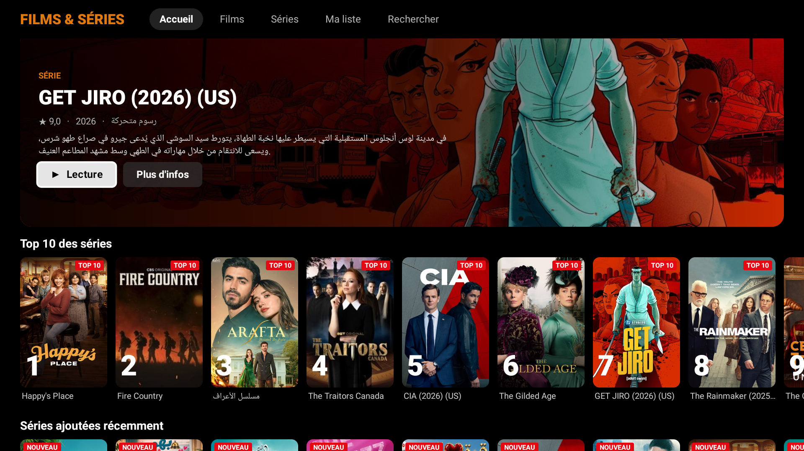
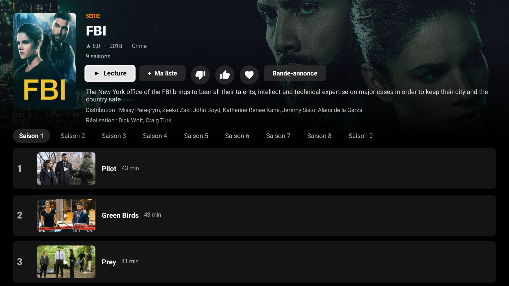

# MediaHub

**Live TV, EPG, movies and series on every screen.** One interface for live TV and on-demand content from
Enigma2 (OpenWebIF), Xtream Codes, M3U playlists, HDHomeRun and Tvheadend, on **Android TV**, **Windows** and any **x86 PC** (MediaHub OS).

> Italiano: [README.it.md](README.it.md)

## Downloads

| Version | File | For |
|---|---|---|
| **Android TV** | [`MediaHub-TV-1.0.48.apk`](https://github.com/corallocla-web/mediahub/releases/download/v1.0.50/MediaHub-TV-1.0.48.apk) | Android TV / Google TV (Sony, Nvidia Shield, Fire TV...) |
| **Windows (per user)** | [`MediaHub-Setup-1.0.10.exe`](https://github.com/corallocla-web/mediahub/releases/download/v1.0.50/MediaHub-Setup-1.0.10.exe) | Installs without administrator rights |
| **Windows (per machine)** | [`MediaHub-1.0.10.msi`](https://github.com/corallocla-web/mediahub/releases/download/v1.0.50/MediaHub-1.0.10.msi) | MSI package for the whole PC (needs administrator) |
| **MediaHub OS (ISO)** | [`mediahub-os-20261102-1645.iso`](https://drive.usercontent.google.com/download?id=1kaO91YQxkLJ9oX0opV1UTpJc6ybqOl9C&export=download&confirm=t) | **Any x86 PC** (mini PCs, Compute Sticks, desktops, laptops, VMs): boots straight into MediaHub, full screen. BIOS and UEFI |

The last 5 versions of each type are listed in [`docs/DOWNLOAD.md`](docs/DOWNLOAD.md) and in [Releases](https://github.com/corallocla-web/mediahub/releases).
Builds are **unsigned**: Windows (SmartScreen) and Android may ask for confirmation when installing.

## Screenshots

## Features

- **Two-pane Home**: channel list with logos on the left; on the right a mini player and the full guide of the selected channel.
  OK on a channel = preview, OK again = full screen.
- **Multiple sources and accounts**: Enigma2/OpenWebIF, Xtream Codes, M3U, HDHomeRun, Tvheadend; quick switch between PVR accounts from the left rail.
- **EPG**: per-channel guide, with an on-disk XMLTV cache for Xtream sources.
- **Movies and series** (Xtream): Netflix-style catalogue, Top 10, "Continue watching", automatic next episode.
- **Radio, music, photos, recordings and timers.**
- **Phone remote** (MediaHub OS): QR code with F12, control panel at `http://<ip>:8080/sistema`.

## Installation

### Android TV
1. Download the APK on a PC or directly on the TV (*Downloader* app), or copy it to a USB stick.
2. Allow "unknown sources" for the app you use to open the file.
3. Install. From a PC: `adb connect <tv-ip>` then `adb install -r MediaHub-TV-*.apk`.

### Windows
- **.exe**: double-click; installs for the current user in `%LOCALAPPDATA%\Programs\MediaHub`. VLC is bundled.
- **.msi**: installs for the whole PC in `C:\Program Files\MediaHub` (administrator). Upgrades an existing install.
- Starts in a window; press **F11** for full screen (or use Settings).

### MediaHub OS (ISO) - any x86 PC
1. Write the ISO to a USB stick (Rufus in **DD mode**, or `dd`).
2. Boot the PC from the stick (BIOS or UEFI) and follow the installer.
3. After the reboot MediaHub starts by itself, full screen.

Check the download against the SHA256 shown on the download page.

## First start
A guided setup asks for the source type and the access data (address, user, password or playlist URL).
Where a QR code is shown you can enter the data from your phone. More accounts can be added from Settings.

## Known issues
- **Empty Xtream guide**: some providers serve the full XMLTV guide only once and then rate-limit it. MediaHub caches it on disk (valid for 6 hours) and reuses the last good copy, but at least one complete download must succeed.
- **Windows**: if VLC is not installed the bundled one is used; the first start is a little slower.
- The Windows and MediaHub OS builds were tested mostly in virtual machines: please report any problem.

## Notes
MediaHub is a player: it does not include channels, playlists or subscriptions. Use it only with content you are entitled to access.
The source code is not public.
